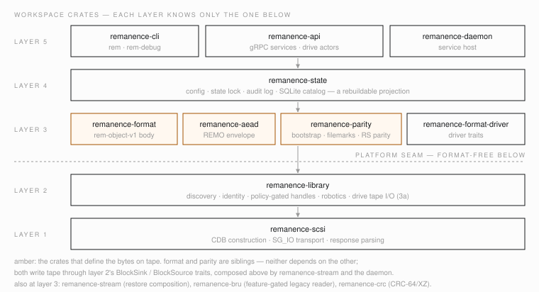

<!-- code-anchor: none -->
# Remanence: Open-Source LTO Tape Archival Software

Remanence writes archives to LTO tape and reads them back, so that the data can
still be read 10 to 20 years from now, after the hardware, the software and the
people who wrote the tapes have changed. Each tape describes itself and the
object format is publicly specified, so a copy never depends on a particular
database, vendor or program staying available. It also supports optional
encryption, erasure-coded recovery from damaged media (extra parity data that
can rebuild unreadable regions), and partial-file
restore, which reads one byte range of a file without reading the whole
object.

[](https://doi.org/10.5281/zenodo.21551570)

**Website:** [archivetech.org](https://archivetech.org) — overview, the formats explained, and how to verify them.

> **Alpha software (v0.2.0).** Do not use it as the only copy of anything. The
> three format specifications are at version 1.0 and are separate from this
> software's version. See [Status](#status).

Remanence is open Rust infrastructure. It is the mechanism layer of an archive
system: a daemon and command-line tools that discover tape libraries, move
cartridges, write self-describing objects with erasure-coded parity, and
account for every byte in a rebuildable catalog. What to archive, when, and
for how long are decisions for whatever orchestrator calls its API.

A tape library is the long-term deployment target, but it is not the entry
price. `rem` can operate one standalone LTO drive directly, with no changer and
no daemon. A home or lab user can insert a cartridge, initialize it, write and
restore files, finalize it, and verify it from the command line. The
[standalone-drive guide](docs/guide-standalone-drive.md) is the shortest path
to a first physical tape. Standalone mode has model-backed integration tests but
has not yet run on a physical standalone drive; the
[tested hardware](docs/status.md#tested-hardware) table lists what has.

Long-term tape archiving is dominated by proprietary systems whose on-tape
formats become unreadable when the vendor disappears, and by tools that treat
tape like a disk. Remanence makes different choices. The object format is publicly
specified and a plaintext object can be read with `bsdtar`. Every tape
describes itself, so no database is the only copy of the truth. When the
hardware leaves the software uncertain about physical state, the software
stops instead of guessing. The reasoning is laid out in
[docs/why-remanence.md](docs/why-remanence.md).

It is developed against a Quadstor virtual tape library and field-tested on an
HPE MSL3040 with LTO-9 drives.

<!-- code-anchor: none -->
## Status

**Version 0.2.0 — alpha.** The implementation has not had enough operational
testing to be trusted with material you cannot afford to lose. Expect defects
and breaking changes. [CHANGELOG.md](CHANGELOG.md) lists the releases,
including the v1.0.0 tag, which is marked superseded because that number
overstated the implementation's maturity.

REM-OBJECT and REM-ENCRYPT are specified, implemented, and pinned by the test
vectors that ship with the source. For REM-PARITY, current `main` writes and
accepts only the terminal-index layout (`schema_major = 2`), which is described
in the revision under `specs/in-progress/` and is not yet a published
specification. The REM-PARITY copy under `specs/publication/` and the published
vector archive describe `schema_major = 1`, which current `main` rejects. Tapes written
by the released v0.1.0 binaries use `schema_major = 1` and cannot be read by
current `main`.

The specification review copies are public, but their concept DOIs (registry entries covering all revisions) are reserved
and the first deposits are still pending. The review checks whether the
documents describe the formats correctly and completely, not whether the design
works. The documents freeze on 31 July 2027, and the guarantee that no tape a
format validates will ever be invalidated begins then. Until then a review
finding could still change what goes on tape, so treat material written during
the window as re-writable. The daemon and its gRPC control surface are released
but may also still change.

The project is young and has run on a narrow range of hardware. Restore and
verify real material on your own equipment before you rely on it.

[docs/status.md](docs/status.md) sets out what works today and what does not.

<!-- code-anchor: Cargo.toml crates/remanence-api/build.rs crates/remanence-cli/src/archive_ingest.rs @ 6ed03ef0 -->
## Build

Rust 1.88+, Linux, and a C compiler (`build-essential` on Debian/Ubuntu, `gcc`
on Fedora). The default build needs no other system packages; the protobuf
definitions are compiled in-process by protox, so `protoc` is not required:

```sh
cargo build --release
```

yields `target/release/{rem,rem-debug,rem-daemon,rem-recover}`. `rem` is the
operator CLI for daemon-backed libraries and policy-gated standalone drives;
`rem-debug` is the break-glass tool with broader direct hardware access.
`rem-recover` is a separate crate that depends on neither the daemon nor the
catalog. One optional feature, `remanence-cli/linux-udev`, adds hot-plug
watching and needs `pkg-config` and `libudev-dev`.

One program is needed at run time: `bsdtar` (the `libarchive-tools` package on
Debian and Ubuntu, `bsdtar` on Fedora). `rem archive build` needs it only to
build an archive that packs files into a `.remwrap.tar` wrapper, and `rem
archive extract` only to extract a whole object that contains one, unless
`--no-unwrap` is given. Extract checks for it before it writes anything.
Range (`--path`/`--range`) and blob-member (`--blob-entry`/`--blob-member`)
extracts never need it. The test suite needs `bsdtar` as well.

Tests and lints, as CI runs them:

```sh
cargo fmt --all --check
cargo clippy --workspace --all-targets -- -D warnings
cargo test --workspace
```

Hardware-touching tests are ignored by default and opt in via
environment variables documented in their test modules.

<!-- code-anchor: crates/remanence-cli/src/lib.rs @ 6ed03ef0 -->
## Quickstart

The native object format works against local files, no tape required. From the checkout, put the built binaries on your path with `export PATH="$PWD/target/release:$PATH"`. In the first command, replace `some-directory` with an existing directory that holds the files you want to archive:

```sh
rem archive build --inputs some-directory --out demo.rem-object
rem archive inspect --object demo.rem-object
rem archive extract --object demo.rem-object --dest restored
```

`demo.rem-object` is a POSIX pax tar stream — `bsdtar -tf
demo.rem-object` lists your files — and it is byte-for-byte what a tape write
stores as the object body. The full walkthrough, from local round trip
to a standalone drive or a changer library, is
[docs/guide-quickstart.md](docs/guide-quickstart.md). If you already have one
LTO drive attached, go straight to the
[standalone-drive guide](docs/guide-standalone-drive.md).

## Documentation

- [Quickstart](docs/guide-quickstart.md) — runnable walkthrough.
- [Standalone LTO drive](docs/guide-standalone-drive.md) — first physical
  tape with one drive, no changer or daemon.
- [Status](docs/status.md) — what works today, what does not, and how
  mature each part is.
- [Architecture overview](docs/architecture-overview.md) — the layer
  stack, write/read paths, and design invariants.
- [CLI reference](docs/reference-cli.md) — the `rem`, `rem-debug`, and
  `rem-daemon` surfaces.
- [Configuration reference](docs/reference-configuration.md) — every
  config key, default, and environment variable.
- [Foreign-format adapter reference](docs/reference-foreign-format-adapters.md)
  — the read-only registry boundary and distribution model.
- [Tape layout reference](docs/reference-tape-layout.md) — what is
  physically on a cartridge.
- [Troubleshooting](docs/guide-troubleshooting.md) — failure modes,
  fences, and permissions.
- [Glossary](docs/reference-glossary.md) — project terms and tape
  vocabulary.
- [How the formats change](docs/versioning-explained.md)
  — the versioning and revision policy, in plain language.
- [The versioning register](docs/versioning-register.md) — every versioned
  component of the system, one entry each: current values, unknown-value
  behaviour, and how each ever changes.
- [The formats, explained](specs/publication/formats-explained.md) —
  a plain-language companion to the specifications: the motivation and
  the design, without the normative terseness.
- [REM Implementation and Operations Guide](specs/publication/rem-implementation-guide.md)
  — informative, tool-neutral practice for implementing and operating the formats.
- Published format specifications:
  [REM-OBJECT Core Format 1.0](specs/publication/rem-object-core-1-specification.md),
  [REM-ENCRYPT 1.0](specs/publication/rem-encrypt-1-specification.md), and
  [REM-PARITY 1.0](specs/publication/rem-parity-1-specification.md), with
  their pinned test-vector archive alongside.
- [proto/layer5.proto](proto/layer5.proto) — the draft gRPC contract.

<!-- code-anchor: crates/remanence-library/tests/platform_dependency_guard.rs @ 7f39930d -->
## Migrating foreign tapes

Core Remanence publishes a read-only adapter registry but includes no concrete
foreign-format parser. A separate distribution can link the formats needed for
a particular migration while retaining the same normalized scan, restore,
recovery, and catalog surfaces. See the
[foreign-format adapter reference](docs/reference-foreign-format-adapters.md).

## Platform crate contract

`remanence-scsi` and `remanence-library` are the reusable tape-platform
crates, and they are format-free: no REM-OBJECT, parity, catalog, or daemon
knowledge lives below that seam. `remanence-scsi` depends on no other
Remanence crate, and `remanence-library` depends only on
`remanence-scsi`. A manifest dependency-guard test enforces the
boundary, so external tools can build their own layout and catalog on
the platform crates without pulling in the bundled formats. Portable
REM-OBJECT files follow the same discipline: they contain only the
object's stored bytes — tape filemarks, bootstrap rows, and parity
sidecars are tape-only framing.

<!-- code-anchor: Cargo.toml @ 7f39930d -->
## Repository layout

```text
crates/remanence-scsi           Layer 1 SCSI CDB/SG_IO primitives
crates/remanence-library        Layer 2 library model/ops and Layer 3a tape I/O
crates/remanence-crc            Shared CRC-64/XZ
crates/remanence-aead           REM-ENCRYPT 1.0 encrypted-representation primitives (fixed REMO family magic; X-Wing HPKE wrapped-DEK)
crates/remanence-format-driver  Published format-driver traits and foreign-adapter registry
crates/remanence-format         Native rem-object-v1 body format
crates/remanence-parity         Layer 3c sidecar parity and recovery
crates/remanence-stream         Restore/recovery streaming composition
crates/remanence-order          Dependency-free read-order planner (wrap-map geometry, cost model, solver) behind remanence-api's PlanBatchRead RPC
crates/remanence-state          Layer 4 catalog, audit, config, lock
crates/remanence-api            Layer 5 gRPC service implementations
crates/remanence-daemon         rem-daemon service host
crates/remanence-cli            rem and rem-debug binaries
crates/rem-recover       Standalone catalogless REM-OBJECT disaster-recovery binary
crates/remanence-chaos          Fault-injection scaffolding (included in CI gates)
specs/publication/              Published format specifications + test vectors
docs/                           Guides and references (see docs/README.md)
proto/                          Layer 5 protobuf contract
verif/                          Lean/Aeneas proof targets
fieldtest/                      Physical field-test kit and runbooks
fixtures/                       Captured hardware/SCSI fixtures
fuzz/                           REM-OBJECT fuzz targets
```



*Fig. 1 — The crate stack: each layer depends only on the one below it; the highlighted crates define the bytes on tape, and everything below the platform seam is format-free.*

## Contributing and security

Issues and pull requests are welcome — see
[CONTRIBUTING.md](CONTRIBUTING.md) for how the project works day to day.
To report a security issue, especially anything affecting the encryption
envelope or the integrity guarantees, see [SECURITY.md](SECURITY.md);
please do not open a public issue for suspected vulnerabilities.
Release history lives in [CHANGELOG.md](CHANGELOG.md). Released
versions are archived on Zenodo. To cite the software, use its concept DOI
[10.5281/zenodo.21551570](https://doi.org/10.5281/zenodo.21551570) (see
[CITATION.cff](CITATION.cff)). The format documents carry reserved concept DOIs
in their Status sections, but their first deposits are pending. Until those
records are published, cite the repository commit and document version rather
than treating a reserved DOI as a resolvable publication.

Maintainer release procedure and artifact policy are in
[RELEASING.md](RELEASING.md).

## License

The Rust reference implementation is `Apache-2.0`, the specifications are
`CC-BY-4.0`, and the conformance vectors are `CC0-1.0`. See
[LICENSING.md](LICENSING.md) for the authoritative path mapping and canonical
license texts.
