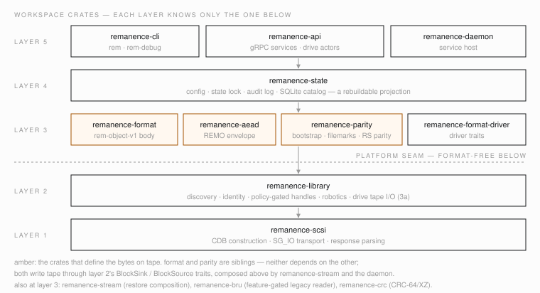

<!-- code-anchor: Cargo.toml crates/remanence-cli/Cargo.toml @ 625f7044 -->
# Remanence: open-source LTO tape archival software

Remanence writes archives to LTO tape and reads them back, so that the data can
still be read 10 to 20 years from now, after the hardware, the software and the
people who wrote the tapes have changed. Each tape describes itself, and the
object format on tape is publicly specified, so reading a tape never depends on
a particular database, vendor or program staying available. Remanence also
offers optional encryption, Reed-Solomon parity that can rebuild unreadable
regions of a damaged tape, and partial-file restore, which reads one byte range
of a file from tape without reading the rest of the archive it belongs to.

It is for people who run tape archives: an operator with a changer library, or
with a single LTO drive, and a developer building an archive system that needs
a tape layer underneath it.

[](https://doi.org/10.5281/zenodo.21551570)

Website: [archivetech.org](https://archivetech.org), with an overview, the
formats explained, and how to verify them.

> Remanence is alpha software, and there is no binary release yet: you build it
> from source. Do not use it as the only copy of anything. The three format
> specifications are at version 1.0, which is separate from the software's
> version. See [Status](#status).

## What it is

Remanence is the mechanism layer of an archive system, written in Rust. A
daemon and command-line tools discover tape libraries, move cartridges, write
objects with parity to tape, and keep a catalog of where every byte is. The
catalog can be rebuilt from the host's per-tape logs and audit log, and a
finalized tape can be read without it. An object is the unit Remanence stores:
an archive of one or more files, written to tape as one tape file. What to
archive, when, and for how long are decisions for the orchestrator, the system
above Remanence that calls its API.

A tape library is the long-term deployment target, but it is not required.
`rem` can operate one standalone LTO drive directly, with no changer and no
daemon: insert a cartridge, initialize it, write and restore files, finalize
it, and verify it from the command line. Standalone mode has model-backed
integration tests but has not yet run on a physical standalone drive; the
[tested hardware](docs/status.md#tested-hardware) table lists what has.

Three design choices follow from that goal. The object format is
publicly specified, and a plaintext object is a POSIX pax archive that `bsdtar`
can read. Every tape describes itself, so no database is the only record of
what a tape holds. When the hardware leaves the outcome of a command in doubt,
Remanence stops and reports it instead of guessing.
[Why Remanence?](docs/why-remanence.md) compares it with the alternatives.

It is developed against a QuadStor virtual tape library and field-tested on an
HPE MSL3040 library with LTO-9 drives.

<!-- code-anchor: none -->
## Status

Remanence is alpha software. The implementation has not had enough operational
testing to be trusted with material you cannot afford to lose, so expect
defects and breaking changes. There is no binary release yet: the only
published release, v0.1.0, contains the test vectors only, and the source is at
version 0.2.0, which was never released.
[Releases and versions](docs/status.md#releases-and-versions) has the detail,
and [CHANGELOG.md](CHANGELOG.md) records the history, including the withdrawn
v1.0.0 tag.

The format specifications are review drafts until they freeze on 31 July 2027.
Until then a review finding could still change what goes on tape, so treat
material written during the review window as re-writable. REM-OBJECT and
REM-ENCRYPT are specified, implemented and pinned by test vectors. For
REM-PARITY, current software writes a newer tape layout than the published copy
describes; [the status page](docs/status.md#the-rem-parity-publication-copy)
explains the gap.

The project is young and has run on a narrow range of hardware. Restore and
verify real material on your own equipment before you rely on it.
[What works, and what does not](docs/status.md) sets out the detail.

<!-- code-anchor: crates/remanence-cli/src/lib.rs crates/remanence-cli/src/archive_ingest.rs @ 625f7044 -->
## Try it without a tape

You need Linux, `git`, a C compiler, Rust 1.88 or newer, and `bsdtar`. Build
Remanence and archive one file into an object on local disk:

```sh
git clone https://github.com/archivetechie/remanence
cd remanence
cargo build --release --locked
export PATH="$PWD/target/release:$PATH"
mkdir -p demo && echo "first file" > demo/notes.txt
rem archive build --inputs demo --out demo.rem-object
rem archive extract --object demo.rem-object --dest restored
diff -r demo restored && echo identical
bsdtar -tf demo.rem-object
```

`rem archive build` and `rem archive extract` each print a one-line JSON
report. The last two commands print:

```text
identical
notes.txt
_remanence/manifest.cbor
```

`demo.rem-object` holds exactly the bytes that a tape write stores for this
object, and `bsdtar` lists it without any Remanence software. The
[quickstart](docs/guide-quickstart.md) continues from here: inspecting objects,
encryption and recovery keys, and a first tape in a library. If you have one
LTO drive and no changer, the [standalone-drive guide](docs/guide-standalone-drive.md)
is the shortest path to a first physical tape.

<!-- code-anchor: Cargo.toml crates/remanence-api/build.rs crates/remanence-cli/Cargo.toml @ 625f7044 -->
## Build

Building needs Linux, Rust 1.88 or newer, and a C compiler (`build-essential`
on Debian and Ubuntu, `gcc` on Fedora). The protobuf definitions are compiled
in-process, so `protoc` is not required.

```sh
cargo build --release --locked
```

This produces `target/release/rem`, `rem-debug`, `rem-daemon` and
`rem-recover`. `rem` is the operator tool for local objects, standalone drives
and daemon-backed libraries. `rem-debug` is the break-glass tool with wider
direct hardware access. `rem-daemon` runs a library and serves the gRPC API.
`rem-recover` opens an encrypted object with no daemon, catalog or
configuration file. A plain build skips the development tool `rem-dev`, which
needs `--features fixtures`. The optional feature `remanence-cli/linux-udev`
adds `rem watch` (hot-plug events) and needs `pkg-config` and `libudev-dev`.

At run time, `rem archive build` and `rem archive extract` need `bsdtar` (the
`libarchive-tools` package on Debian and Ubuntu, `bsdtar` on Fedora) for
objects that pack files into a `.remwrap.tar` wrapper.
[Installing Remanence](docs/guide-install.md) covers installation and host
preparation for tape hardware.

Tests and lints, as CI runs them (the tests also need `bsdtar`):

```sh
cargo fmt --all --check
cargo clippy --workspace --all-targets -- -D warnings
cargo test --workspace
```

Tests that touch hardware are ignored by default; their test modules document
the environment variables that enable them.

## Documentation

- [Concepts](docs/concepts.md): how a tape behaves, and the terms the rest of
  the documentation uses.
- [Quickstart](docs/guide-quickstart.md): a walkthrough from a clean checkout to
  a first tape.
- [Installing Remanence](docs/guide-install.md): building, installing, and
  preparing a host for tape hardware.
- [Using a standalone LTO drive](docs/guide-standalone-drive.md): a first
  physical tape with one drive and no changer.
- [What works, and what does not](docs/status.md): maturity, releases and
  tested hardware.
- [Documentation index](docs/README.md): every guide, reference and
  explanation.
- [The formats, explained](specs/publication/formats-explained.md): a
  plain-language companion to the specifications.
- Published format specifications:
  [REM-OBJECT Core Format 1.0](specs/publication/rem-object-core-1-specification.md),
  [REM-ENCRYPT 1.0](specs/publication/rem-encrypt-1-specification.md) and
  [REM-PARITY 1.0](specs/publication/rem-parity-1-specification.md), with their
  pinned test-vector archive alongside.
- [proto/layer5.proto](proto/layer5.proto): the draft gRPC contract.

<!-- code-anchor: crates/remanence-format-driver crates/remanence-library/tests/platform_dependency_guard.rs @ 625f7044 -->
## Tapes written by other software

Core Remanence publishes a read-only registry for adapters that read other
archive formats, but it includes no such adapter itself. A separate
distribution can link the adapters needed to read a particular collection of
old tapes, and use the same scan, restore, recovery and catalog commands. The
[foreign-format adapter reference](docs/reference-foreign-format-adapters.md)
describes the boundary.

<!-- code-anchor: Cargo.toml @ 625f7044 -->
## Repository layout

```text
crates/remanence-scsi           SCSI command building, response parsing and SG_IO
crates/remanence-library        Library model, robotics and tape I/O
crates/remanence-crc            Shared CRC-64/XZ
crates/remanence-aead           REM-ENCRYPT encrypted-representation primitives
crates/remanence-format-driver  Format-driver traits and the foreign-adapter registry
crates/remanence-format         The native rem-object-v1 body format
crates/remanence-parity         Sidecar parity and recovery
crates/remanence-stream         Restore and recovery streaming
crates/remanence-order          Read-order planner for batch reads
crates/remanence-state          Catalog, tape logs, audit log, configuration, state lock
crates/remanence-api            gRPC service implementations
crates/remanence-daemon         The rem-daemon service host
crates/remanence-cli            The rem and rem-debug binaries
crates/rem-recover              Standalone recovery binary for encrypted objects
crates/remanence-chaos          Fault-injection scaffolding (run in CI)
specs/publication/              Published format specifications and test vectors
docs/                           Guides and references (see docs/README.md)
proto/                          gRPC protobuf contract
verif/                          Lean and Aeneas proof targets
fieldtest/                      Physical field-test kit and runbooks
fixtures/                       Captured hardware and SCSI fixtures
fuzz/                           REM-OBJECT fuzz targets
```

`remanence-scsi` and `remanence-library` are reusable tape-platform crates and
know nothing of the formats, the catalog or the daemon. `remanence-scsi`
depends on no other Remanence crate, `remanence-library` depends only on
`remanence-scsi`, and a dependency-guard test enforces that boundary, so other
tools can build their own layout and catalog on these two crates.



*Fig. 1. The crate stack. Each layer depends only on the ones below it; the
highlighted crates define the bytes on tape, and everything below the platform
seam is format-free.*

## Contributing and security

Issues and pull requests are welcome; [CONTRIBUTING.md](CONTRIBUTING.md)
explains how the project works day to day. To report a security issue,
especially anything affecting the encryption envelope or the integrity
guarantees, see [SECURITY.md](SECURITY.md), and do not open a public issue for
a suspected vulnerability. [RELEASING.md](RELEASING.md) describes the
maintainers' release procedure and artifact policy.

Released versions are archived on Zenodo. To cite the software, use its concept
DOI [10.5281/zenodo.21551570](https://doi.org/10.5281/zenodo.21551570) (see
[CITATION.cff](CITATION.cff)). The format documents carry reserved concept DOIs
in their Status sections, but their first deposits are pending. Until those
records are published, cite the repository commit and document version rather
than a reserved DOI.

## License

The Rust reference implementation is `Apache-2.0`, the specifications are
`CC-BY-4.0`, and the conformance vectors are `CC0-1.0`. See
[LICENSING.md](LICENSING.md) for the authoritative path mapping and the
license texts.
