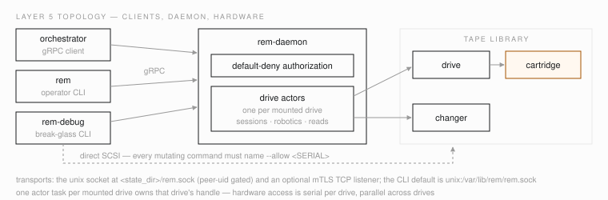

# Architecture overview

This document describes how Remanence is built: which programs and libraries
make up the system, what each layer is responsible for, and what happens
inside the daemon or a direct standalone-drive invocation when an object is
written to tape or read back. It is written for someone who wants to
understand the system before using it,
extending it, or reviewing it. For the byte-level formats see the
[tape layout reference](reference-tape-layout.md).

A few terms recur throughout. A **tape file** is the unit between two
**filemarks**, the separator marks a tape drive records on the medium. **BOT**
and **EOD** are the beginning of tape and the end of recorded data. A **CDB**
is the command block of the SCSI protocol that drives and robots speak. An
**Object** is the unit Remanence stores: one archive holding one or more files
plus a manifest. An **orchestrator** is the separate program that decides what
to archive and when, and calls Remanence's API to do it. Other terms are
explained where they first appear and are collected in the
[glossary](reference-glossary.md).

<!-- code-anchor: Cargo.toml @ 7f39930d -->
## The layer model

Remanence is organized as a stack of five layers. Each layer depends only on
the one below it. The two lowest layers know nothing about Remanence's
formats, so other tools can build on them:

```text
Layer 5   remanence-api, remanence-daemon, remanence-cli
          gRPC services, drive actors, sessions, operator CLIs
Layer 4   remanence-state
          config, state lock, audit log, rebuildable SQLite catalog
Layer 3   remanence-format (3b: rem-object-v1 body)   remanence-parity (3c: parity)
          + remanence-aead (REMO HPKE envelope), remanence-format-driver (traits),
            remanence-stream (composition)
Layer 2   remanence-library
          discovery, identity, policy-gated handles, robotics, tape I/O
Layer 1   remanence-scsi
          CDB construction, SG_IO transport, response parsing
```

Layers 3b and 3c are siblings and do not depend on each other: both build on
the `BlockSink`/`BlockSource` traits (Rust interfaces for writing and reading
blocks) that Layer 2 defines. The format layer writes an object's stored
blocks. The parity layer owns the physical tape layout around them: the
bootstrap, the filemarks, and the parity sidecars.

Two crates sit outside the stack. `crates/rem-recover` is a standalone
disaster-recovery binary that links `remanence-aead`, `remanence-format`,
`remanence-library`, and `remanence-stream` directly and skips Layers 4 and 5.
It lets an encrypted REM-OBJECT envelope be decrypted and restored with
nothing but the object bytes and one matching recipient private key, with no
daemon, no catalog, and no config file. It is meant for the case where the
rest of the stack is unavailable or cannot be trusted.

`remanence-order` sits beside Layer 5. It is a pure-computation crate with no
Remanence dependencies of its own, and `remanence-api` is its only caller; see
[Read-order planning](#read-order-planning) below.


*Fig. 1 — The workspace as a stack: each layer depends only on the one below it, and the format-defining crates sit directly above the format-free platform seam.*

<!-- code-anchor: crates/remanence-scsi/src/lib.rs crates/remanence-library/src/lib.rs @ 1dd451b2 -->
## Layers 1 and 2: the tape platform

`remanence-scsi` is the lowest crate. It builds CDBs, sends them to devices
through the Linux SG_IO ioctl (the kernel call that passes a raw SCSI command
to a device), and parses the responses: INQUIRY, READ ELEMENT STATUS, sense
data, mode pages, LOG SENSE, and positioning. The parsers are portable Rust;
only the transport is Linux-specific.

`remanence-library` turns raw devices into a joined model of libraries,
drives, and cartridges. Discovery issues READ ELEMENT STATUS to every changer
(the robot) and INQUIRY plus VPD page 0x80 to every sg device, then joins the
two by serial number, which yields statements such as "bay X of library L
holds drive S, reachable at /dev/sgN right now". Device paths such as
`/dev/sgN` can change, so identity is always the serial number, checked again
when a handle is opened. Handles gate every state-changing operation behind an
access policy (the allowlist) and set a dirty flag when a command's completion
is uncertain.

This crate also carries Layer 3a, drive tape I/O. Streaming reads and writes
of object data use one pipelined, fixed-block path (full verification reads
separately, through its own strict batch reader). The configuration keys
`tape_io.legacy_single_block` and `tape_io.pipelined_submission` are not
accepted: a `config.toml` that sets either fails to load with an error naming
the key. "Pipelined" means the staging ring described under
[The write path](#the-write-path) below. It does not mean concurrent SCSI
commands: exactly one command is in flight at a time, because one OS thread
issues blocking `sg_io` calls in sequence.

The block-I/O interface is split in two. `BlockRead` offers pure data
transfer. `BlockSource` adds batch and handoff reads and `prove_read_position`,
which issues a real SCSI READ POSITION command and returns the drive's answer
as proof of where it is. Format-parsing code that holds only a `BlockRead`
therefore cannot issue LOCATE, SPACE, or READ POSITION, and a compile-fail
test enforces this. Readiness classification (bootstrap validation and the
media state machine) and the udev hot-plug watcher also live in this crate.

Every write-direction CDB passes through one media-write fence
(`MediaFencedTransport`). Before the first media-modifying command of a load,
the fence durably advances the volume's write epoch and marks the volume
uncalibrated. [Read-order planning](#read-order-planning) below explains what
the epoch protects.

<!-- code-anchor: crates/remanence-library/tests/platform_dependency_guard.rs .github/workflows/ci.yml @ 7f39930d -->
### The platform seam

`remanence-scsi` and `remanence-library` are the reusable tape-platform
crates. By contract they contain no REM-OBJECT, parity, catalog, or daemon
knowledge. Two tests enforce the contract. A manifest-parsing test asserts
that `remanence-scsi` and `remanence-aead` depend on no internal crate and
that `remanence-library` depends only on `remanence-scsi`. A second dependency
guard asserts that the core workspace contains no concrete foreign-format
adapter. An external project can therefore build its own tape layout and
catalog on the platform crates without taking on Remanence's formats.

<!-- code-anchor: crates/remanence-format/src/lib.rs crates/remanence-parity/src/lib.rs crates/remanence-aead/src/lib.rs crates/remanence-aead/src/wrap.rs crates/remanence-aead/src/header.rs crates/remanence-format-driver/src/lib.rs crates/remanence-stream/src/lib.rs crates/remanence-crc/src/lib.rs @ bc2f9f90 -->
## Layer 3: formats and parity

Six crates share this layer.

- `remanence-format` implements `rem-object-v1`, the native body format. A
  stored object is one pax tar archive (the POSIX extended tar format),
  aligned to fixed-size chunks, self-describing, and ending with a CBOR
  manifest (CBOR is a compact binary encoding of structured data). The crate
  also reads part of a file by skipping directly to the member's blocks. Its
  "covering range" computation maps a requested plaintext byte range to the
  smallest span of AEAD chunks that must be fetched and decrypted to serve it.
  (AEAD is authenticated encryption: each chunk is both encrypted and
  checked for tampering.)
- `remanence-aead` is the isolated cryptography crate. It implements the
  `REMO` encrypted envelope of REM-ENCRYPT 1.0, with on-tape
  `format_version = 2`: HKDF-SHA-256 key derivation and a ChaCha20-Poly1305
  STREAM construction. It generates a fresh data-encryption key for each
  object and wraps a copy of that key for each recipient using HPKE Base mode
  with the X-Wing hybrid KEM (ML-KEM-768 combined with X25519, per
  `draft-connolly-cfrg-xwing-kem`; IANA HPKE KEM id `0x647a`). The wrapped
  copies sit in a `REMK`-tagged key frame between the header and the metadata
  frame. Readers accept 1-8 slots; production sealers require 2-8 distinct
  epochs. There is no shared secret. Wrap-suite id `0x01` (an X25519-only KEM)
  and format version 1 are permanently forbidden: they are rejected on both
  read and write (REM-ENCRYPT Section 10). The
  crate depends on no other Remanence crate, so the envelope can be audited on
  its own. `remanence-format` wraps its whole-object and ranged primitives and
  is the single entry point used by the CLI, the API, and `rem-recover`.
- `remanence-parity` owns the physical tape layout: bootstrap blocks, filemark
  discipline, Reed-Solomon sidecar parity, resume after interruption, and
  recovery without a catalog. The main recovery structure is the terminal
  index, three complete inventories written at the tail of the tape. They are
  read from EOD, without walking through any Object. If no terminal replica
  survives, the fallback is a structural scan of the whole tape from BOT. On
  clean reads this crate does nothing visible; on medium errors it
  reconstructs the missing blocks.
- `remanence-format-driver` publishes the normalized reader traits and the
  registry used by auxiliary, read-only foreign-format adapters. The default
  registry is empty. Concrete adapters, and binaries that include them, are
  distributed separately from this workspace.
- `remanence-stream` combines 3b and 3c for whole-file workflows. It scans
  local files in a first pass, streams them through the format and parity
  layers, projects catalog rows, and restores objects to a directory,
  including sparse recovery of damaged archives.
- `remanence-crc` provides the CRC-64/XZ checksum used by the parity structures
  and the audit log.

`archive build` and pool-selected `archive write` produce the encrypted
representation when given 2-8 ordered `--recipient` REMR files (public
recipient key files). Without recipients the body is plaintext. `archive
reseal` re-seals an object completely to rotate its recipients. Whole,
streaming, and ranged opens use a REMP `--private-key` file; the key's epoch id
selects the matching slot in the key frame. `rem-recover` performs the same
encrypted open without the daemon, catalog, or config.

<!-- code-anchor: crates/remanence-state/src/lib.rs crates/remanence-state/src/state.rs @ 244bc6de -->
## Layer 4: state

`remanence-state` holds everything the daemon remembers: the validated
operator configuration, an exclusive state lock, the append-only audit log, and
the SQLite catalog. The catalog is a projection of other records, not the
source of truth: `rebuild_index_from_journals` replays the audit log and the
per-tape journals to regenerate it. A catalog opened read-only is never
migrated. The schema is version 18, tracked in SQLite's `user_version`. Its
tables cover tapes, pools, tape files, objects, copies and files, catalog
units, sessions, operations, idempotency keys, media-readiness records,
tape-I/O fences, wrap-map cache rows, and the drive-stewardship set (drives,
events, health snapshots, clean runs, and alarms).

`rem-daemon` holds a kernel `flock` on `<state_dir>/state.lock` for as long as
the process runs. `StateHandle`-based `rem-debug` mutations take the same lock.
These are offline operations such as tape init, adopting the identity of an
existing bootstrap, pool operations, and catalog reset. A second daemon cannot
avoid the lock by choosing a different socket, and an offline command cannot
race SQLite, checkpoint recovery, or the hash-chained audit log while the
daemon runs. The kernel releases the lock when the owning process dies.
Maintenance procedures stop the daemon before taking it.

Catalog reset goes through a single admission check. A current catalog is
inspected normally. A catalog at schema 16 or 17, which this version cannot
migrate, may be inspected only for one purpose: erasing the whole catalog while
preserving nothing. For that, the reader lists every bound tape and refuses any
label outside the erase allowlist. It does not preserve or migrate the old
rows. It records the observed schema and tape identities in a token that the
mutation checks again under the same lock. The result is a safe path to an
empty catalog without relaxing the ordinary refusal to open an incompatible
catalog.

How a tape is recognized and adopted when the catalog has no record of it, and
why that step records identity only, is described in [Importing and recovering
Remanence tapes](importing-and-recovering-remanence-tapes.md).

<!-- code-anchor: proto/layer5.proto crates/remanence-api/src/lib.rs crates/remanence-daemon/src/lib.rs @ 7f39930d -->
## Layer 5: daemon and API

Clients talk to `rem-daemon` over gRPC (a remote-call protocol built on
HTTP/2). The contract is package `remanence.api.v1`, defined in
`proto/layer5.proto`. It is an implementation draft with no wire-stability
promise. `rem-daemon` serves seven services:

| Service | Surface |
|---|---|
| `Daemon` | health, version, operation lifecycle (get/list/cancel/watch) |
| `LibraryService` | inventory, drive stewardship, alarms, live status (incl. an advisory `drive_assignments` projection of the per-bay reservation state, for an external arbitration client — read-only, cannot gate a mount), robotics (move/load/unload); `ImportElement`, `ExportElement` and `StreamLibraryEvents` are defined but return unimplemented |
| `Catalog` | tapes, pools, tape files, object enumeration, catalog units, reconcile; `StartTapeVerification` starts a cancellable `tape_verification` operation, `GetTapeVerification` fetches its retained verdict, and `VerifyTapeIndex` starts and waits for the same operation; scoped and paginated enumeration is not implemented (only the unscoped, unpaginated case works) |
| `WriteSessionService` | open (pool and pinned-tape targets — drive targets are unimplemented), client-streamed append, explicit checkpoint, close, abort; opt-in batched durability is parity-off only; write-session restart (`recover_session_id`) is not implemented, and the restart support described under [The read path](#the-read-path) covers reads only |
| `ReadSessionService` | open (tape targets only), server-streamed object/file/byte-range reads, close; `OpenReadSession` accepts an optional resume target, so a client that lost its session in a restart can reopen against durable coordinates (tape UUID, object/file id, file-boundary offset); see [The read path](#the-read-path) |
| `ReadPlanService` | `PlanBatchRead` — an advisory read-ordering RPC for a batch of targets on one tape; it moves no tape, and no client in this repository calls it; see [Read-order planning](#read-order-planning) |
| `Audit` | registered on both the Unix socket and mTLS TCP listeners; its one RPC, `QueryAudit`, streams the append-only audit log back incrementally paged |

The daemon listens on a Unix socket and, optionally, on an mTLS TCP listener
(TCP with mutual TLS certificate authentication). Both use 4 MiB HTTP/2
flow-control windows and a 30 second keepalive interval with a 20 second
timeout. The Unix socket has mode 0660 and accepts only the root user and the
daemon user, checked by peer uid.

Authorization is default-deny. A client's role comes from the mTLS certificate,
through an explicit `remanence-role=` subject attribute (a bare CN is never
used), or, on the trusted local socket, is the system role. Every RPC checks a
permission matrix with six permissions (`Read`, `ReadTape`, `Write`,
`Robotics`, `Lifecycle`, `OperationControl`) before it touches state.

Inside `remanence-api`, every configured library has a dedicated changer actor
and every drive has a dedicated actor that owns its handle. An actor is a
single task that owns a piece of hardware and receives requests one at a time.
A drive's runtime identity is `(library serial, bay element address)`, because
bay numbers are unique only within one changer. Sessions, robotics, and reads
are routed by these composite identities. Hardware access is therefore
serialized per drive, while drives in the same library or in different
libraries run in parallel. Tape UUID reservations are global across the daemon.
An operation addressed by tape UUID requires the cartridge's barcode to
resolve to exactly one operated library before any changer command is sent.

Standalone operation is a second Layer 5 adapter over the same lower layers.
The `rem` process performs discovery, opens `remanence-state`, and constructs
an `OperatorMount` for one explicitly authorized SCSI device. Its durable
endpoint is `DriveKey::Standalone { drive_serial }`; no library serial, bay, or
home slot is invented. There is no gRPC hop, changer actor, or long-running
drive actor because one process owns one loaded cartridge for one invocation.
The mount backend still installs the calibration fence, records audit and
session state, runs the checkpointed writer or common restore/finalization
code, and raises a durable tape-I/O fence when write completion is uncertain.
Moving a tape between a standalone drive and a library therefore does not
change its on-tape format or identity.

The crate is organized as thin public interfaces over focused service, daemon
state, drive-owner, and pool-writer modules. The module map and the ownership
rules for adding new code are in [Remanence API module
organization](api-module-organization.md).



*Fig. 2 — Layer 5 topology: clients reach `rem-daemon` over the unix socket or mTLS TCP, every RPC passes the default-deny role check, and one actor per mounted drive serializes hardware access; `rem-debug` has an allowlist-gated direct SCSI path for emergency work.*

The figure shows the multi-drive daemon topology. The standalone `rem` path
described above runs beside it and deliberately has no changer or service
process.

<!-- code-anchor: crates/remanence-api/src/mount.rs crates/remanence-api/src/pool_write.rs crates/remanence-api/src/write_owner.rs crates/remanence-state/src/index.rs @ 7f39930d -->
## The write path

This section follows one object from an orchestrator's daemon request to a
committed copy on tape. The standalone CLI replaces pool selection and
robotics with the already loaded `--device`, then enters the same preparation,
checkpoint, parity, catalog, and finalization machinery. The steps are
numbered, and the notes after them cover retries, crashes, and end-of-tape
finalization.

1. `OpenWriteSession` names a tape pool. The daemon selects a tape according
   to the pool's policy and watermarks, reserves it, moves it by robot into a
   free drive, and hands the session to that drive's actor. A request may
   instead pin a specific tape UUID. The same pool, writability, and fencing
   checks then apply as for pool selection; see [`rem put
   --tape`](reference-cli.md#writing-to-tape).

   The daemon reserves the drive bay before any robot motion. It uses the
   bay that already holds the selected tape, otherwise the first idle empty
   bay, otherwise an idle bay whose cartridge can return to an empty home
   slot. Bays that another session or readiness wait holds are skipped, so
   concurrent opens on different pools land on different bays.

   Robot moves in one library are serialized behind media readiness. A load
   records a media-readiness fence until the drive reports READY, and the
   open probes readiness only briefly, so on real drives a cold load commonly
   leaves a resumable fence. The daemon starts its readiness wait after the
   refusing caller releases the drive, and also resumes eligible startup fences.
   The wait uses a 9000 s timeout and 30 s steady polls. While a fence is active,
   every request in that library that needs the robot is refused with the fence's
   operation id, even when other bays are idle. Resume calls attach to the same
   running wait. A different drive holder keeps the busy refusal. Detached
   verification and manual finalization watch the fence and retry their open
   within one 15-minute budget. Release-only fences and operator-cancelled waits
   require operator action. [Media-readiness fences and quarantine](guide-troubleshooting.md#media-readiness-fences-and-quarantine)
   covers these states.
2. The actor prepares the drive: it rewinds, reads the bootstrap at BOT, and
   verifies that the tape UUID matches what the catalog expects. A tape that
   cannot prove its identity is never written.
3. `AppendObject` streams chunks of the object to the daemon. The default
   staging mode is `[daemon] append_staging_mode = "overlap"`. A logical append
   uses a bounded ring when it supplies a nonempty caller object ID, a binding
   start digest, replay-from-start capability, and a declared size at least
   `append_overlap_min_bytes`. The threshold defaults to `append_ring_bytes`
   (8 GiB). Smaller objects use the spool with reason `below_overlap_min` and
   share checkpoint batches. The threshold sets no minimum accepted object size.

   The ring reserves the smaller of its configured capacity and the declared
   size rounded up to a 1 MiB slab. If the shared memory reservation is
   unavailable, the append fails with `RESOURCE_EXHAUSTED` before payload receive.
   The ring checks the received digest at the end while holding back the last
   slab. A mismatch leaves the object incomplete and uncommitted. Its internal
   checkpoint retains all committed receipts for the caller's next
   `CheckpointSession` or close, including earlier objects in the same batch.

   Other supported streams and explicit `"serial"` mode use a private staging
   file (mode 0700, named `spool-<uuid>.bin`). Every spool hashes bytes as they
   arrive. The daemon checks the caller's digest before writing to tape and
   verifies that the completed spool size matches the received byte count
   before motion. Preparation reuses the receipt digest; the writer also checks
   the streamed bytes. Spool memory shares `daemon.io_memory_ceiling` (default
   24 GiB) with rings and read reservoirs. A tmpfs spool also requires an
   acknowledged `spool_tmpfs_ram_budget`. Startup deletes spool files left by
   the daemon's earlier unclean exit before resolving the budget. The
   [configuration reference](reference-configuration.md) lists the admission
   settings.

   A separate canonical-object start message handles an already-built
   plaintext REM-OBJECT. It always uses the completed spool, never overlap mode.
   Before any media motion the daemon verifies the whole-object digest, the
   embedded object and caller identities, fixed-block alignment, the member
   digests, the final manifest, the deterministic layout, and the zero fill
   after the tar end-of-archive marker. It then copies those blocks to tape
   unchanged, instead of wrapping the object as one outer file.
4. The object is laid out as a plaintext `rem-object-v1` body or sealed as a
   recipient envelope, then written through the parity sink. Tape I/O is
   pipelined. A fixed pool of page-aligned staging-ring buffers
   (`tape_io.staging_ring_buffers`, default 4) is filled by a producer thread
   while a submitter issues one blocking `WRITE(6)` batch at a time. After
   every successful command the byte and position accounting is updated in
   place. A periodic real READ POSITION check (`tape_io.position_check_bytes`,
   default 1 GiB) catches silent drift between the host's idea of the position
   and the drive's. The object ends with a filemark, and parity sidecars follow
   according to the scheme.
5. The commit is one SQLite transaction that records the object, copy, and
   file rows and the tape-file bundle after the tape write has completed. The
   locator returned to the caller ties the copy to physical media.
6. Failures stop the write, at three levels. When a staging-ring transfer
   fails, the first sink error discards any batches still queued for that
   `AppendObject` call. A failed `AppendGate` makes every later append in that
   write session fail, until the caller opens a new session. A transfer error
   whose outcome is unknown records a durable tape-I/O fence, which blocks
   further writes, and daemon startup, until an operator releases it.

### Retries and idempotency

A repeat of the same `(pool, caller_object_id)`, input kind, content, and copy
intent returns the matching committed copy and does not write a second time.
For a logical file, the archived member path is part of the identity too. Copy
intent is plaintext versus encrypted and, for encrypted copies, the exact
ordered list of recipient epoch ids. A canonical REM-OBJECT already binds all
its member paths in its bytes, so the `archive_path` argument is ignored for
that input kind. Any mismatch under a reused id is a conflict.

Write sessions cannot be resumed: `recover_session_id` is rejected as
unimplemented, unlike the read side below. A WRITTEN response is advisory and
carries no locator. A caller keeps the source until `CheckpointSession` returns
the committed copy set. After any loss of the session, the stream, or the
daemon, the caller re-sends every object that was not reported CHECKPOINTED.
The retry is the complete Object from byte zero, not a continuation.

For an open, parity-off, rewritable tape, the durable checkpoint journal
identifies the last committed EOD. After a restart the daemon locates there and
overwrites any longer uncommitted tail, then writes the retried Object's single
trailing filemark. A multi-member REM-OBJECT therefore stays one ordinary tar
stream that standard tools can recover after a crash, and not two tape files
that tar would have to join. Ordinary Object admission requires the drive to
report `NotWorm`. WORM and unknown media are refused, because an interrupted
tail on them could not safely be replaced. Finalization of the terminal index
only appends, and it has its own WORM-aware recovery, so it remains available.

One-shot direct writes first replay the whole configured checkpoint-journal
tree and resolve an exact committed retry from host state before any tape is
selected. An idempotent success therefore needs neither a writable tape nor
robot motion. The checks are repeated at drive-bound admission. A replay
returns only a copy whose stored representation and ordered recipient ids match
the request, and it never relabels an old copy from new retry arguments. The
pool policy, journal paths, and resource ceiling come from the exclusively
locked state configuration. If an append fails and its rollback also fails, the
error is typed as uncertain durable authority, and the pending identities are
quarantined until a restart and journal reconciliation.

### Finalization

When a tape is closed, no intermediate index is written. Finalization closes
the open parity epoch and emits one final ParityMap if any sidecar metadata
exists. It then fixes one immutable snapshot of the complete prefix that
precedes replica A, and emits replica A, separation AB, replica B, separation
BC, and replica C. A filemark and a persistence barrier follow each component,
and the daemon durably records each proved boundary before it advances.

For parity tapes, the checkpoint journal and the Layer 3c tape-file journal
together are the required authority for the open prefix and for terminal
progress. The first durable finalization transition permanently disables Object
admission. A failure puts the tape in `RecoveryRequired`, where only missing
terminal suffix components may be repaired, at proved positions. There is no
path back to Open and no second terminal suffix. SQLite is a replayable
projection. On a finalized cartridge, the three terminal replicas provide
authority without any catalog: the reader selects C, then B, then A, and
requires agreement among the survivors. The [on-tape layout
reference](reference-tape-layout.md#finalization-and-catalog-less-recovery)
describes the finalization lifecycle, the companion intent (the host's durable
record of a finalization in progress), and the recovery rules.

When a finalization completes, Remanence ensures that the append-only audit log
holds exactly one `TapeSealed` fact for the tape and, for an operator's
close-out, exactly one `OperationFinished` fact bound to the operator's
identity in the sealed checkpoint. Each is decided by reading before appending,
under the audit append lock, so a repeat after an interruption neither loses
nor duplicates it. Both facts are fsynced whatever the configured audit fsync
setting is.

<!-- code-anchor: crates/remanence-api/src/read_core.rs crates/remanence-api/src/write_owner.rs crates/remanence-state/src/checkpoint.rs crates/remanence-parity/src/journal.rs @ 6ed03ef0 -->
## The read path

`OpenReadSession` resolves the object to a tape, mounts it, and checks the
loaded tape's identity again before serving anything. A read spaces directly
to the recorded tape file and streams the payload out in bounded chunks, so an
object is never held in memory whole. Reads of a file or a byte range skip to
the member's chunk-aligned blocks. Parity does nothing unless a medium error
forces reconstruction.

Every read session gets a new session id; sessions are not continued. A client
that lost its session, most often because the application restarted, can
present a **resume target** instead of starting from scratch. The target is
`(tape_uuid, object_id, file_id, file_boundary_byte_offset)`, and optionally the
logical block address (LBA) the client last expected. The daemon treats this as
a fresh open with a different starting position:

1. It compares the mounted tape's on-tape UUID with the target's before it
   trusts any position, so a swapped or stale cartridge is rejected even if it
   happens to have a matching LBA.
2. It rejects any offset that does not fall exactly on a catalogued file
   boundary. A read cannot resume in the middle of a file.
3. It spaces to that boundary.
4. It returns a real device position proof (a SCSI READ POSITION result, not an
   arithmetic estimate) together with the new session and the daemon's epoch
   counter. A change in the counter tells a client that it is talking to a
   restarted daemon.

Delivery is backpressured through a reservoir of host RAM, not an unbounded
channel. A submitter thread fills a shared reservoir up to a high watermark
(`tape_io.read_reservoir_bytes`, default 8 GiB; the high and low watermarks
default to 90% and 25%). It then parks the drive until the consumer has drained
the reservoir below the low watermark. Each time it resumes from a park, it
proves its device position with a real READ POSITION. Byte-range reads also
hold back data from the decoder until a proof has covered it (the
proof-frontier check), so a caller streaming a range never receives bytes the
drive has not confirmed reaching. The reservoir draws on the same
`daemon.io_memory_ceiling` budget as the write-side spool. Every pipeline run
writes two structured JSON diagnostic log lines (`open` and `close`, target
`remanence_read_diag`) with occupancy, park-cycle, and feed-gap timings;
[Troubleshooting](guide-troubleshooting.md) explains how to read them.

A byte range that has already been fetched as raw ciphertext can be decrypted
without a live tape session. `remanence-aead`'s covering-range computation maps
the requested plaintext range to the minimal span of AEAD chunks that cover it,
and a bounded streaming decrypt authenticates and trims exactly those chunks.
The CLI's `archive covering-range` and `archive extract-stream` commands do
this locally, without a gRPC read session.

In plain terms, a read checks that the right tape is in the drive, goes
straight to the recorded position, and hands the data on at the pace the client
can take it. The drive repositions only when it has to.

<!-- code-anchor: crates/remanence-order crates/remanence-api/src/calibration.rs crates/remanence-api/src/read_plan.rs crates/remanence-state/src/calibration.rs crates/remanence-scsi/src/read_end_of_wrap_position.rs crates/remanence-scsi/src/report_supported_opcodes.rs @ 1dd451b2 -->
## Read-order planning

A tape is a linear medium, so the order in which several objects are read from
one tape changes how long the drive spends winding. `remanence-order` is a
pure-computation crate containing geometry tables, an exact-rational cost
model, and a deterministic ordering solver. `remanence-api` calls it to answer
`ReadPlanService.PlanBatchRead`. Given a batch of read targets on one tape, the
RPC returns a recommended visiting order and a time estimate for each hop. A
plan never touches media and commits nothing; a caller may ignore it. No CLI
command in this repository issues the RPC. It is meant for an external
orchestrator. [pfr-reference.md
§8](pfr-reference.md#8-read-ordering-and-batch-restore) gives the full design
rationale.

The plan relies on a wrap map, a record of where each wrap ends. A wrap is
one pass along the tape in one direction, and successive wraps alternate
direction. The map is harvested when a drive is freshly loaded, after the
cartridge's identity has been verified. After an RSOC (Report Supported Opcodes) probe
confirms that the drive supports the command, the actor issues `READ END OF
WRAP POSITION` (`A3h/1Fh/45h`, long form) and validates the result through
`remanence-order` before installing it.

The map, the write epoch that guards it, and a monotonic calibration
generation are stored in a durable calibration-control store under
`remanence-state`, at `<state_dir>/calibration/control.remcalibration`. This
store lies outside the rebuildable SQLite catalog. A `wrap_maps` SQLite row
allows fast lookup. Any media-modifying command in the same load durably
advances the write epoch and marks the volume uncalibrated again, so a stale
map is never served; [Layers 1 and 2](#layers-1-and-2-the-tape-platform)
describe the media-write fence that does this. Media the drive cannot
recognize, and media where drive compression prevents deterministic wrap
boundaries, are classified as unsupported and skipped.

<!-- code-anchor: none -->
## Design invariants

Four rules shape the rest of the design.

- **The tape is the authority.** Every tape describes itself through its
  bootstrap, manifests, and sidecars. The host catalog is a projection that can
  be rebuilt, so losing the SQLite file loses no data.
- **Identity comes from serials and UUIDs.** `/dev/sg7` and barcodes are
  labels. They are resolved fresh each time and never trusted as identity.
- **Uncertainty stops the operation.** When the outcome of a command is
  uncertain, Remanence marks the state dirty or writes a fence, and it does not
  assume success. The worst archival outcome is data that looks intact and is
  not, so failures are made explicit.
- **Policy belongs to the caller.** Remanence decides how bytes get onto tape
  safely. What to archive and when, including retention, scheduling, and
  workflow, belongs to the orchestrator that calls the API.

<!-- code-anchor: crates/remanence-chaos/src/lib.rs @ f643f8c2 -->
## Testing infrastructure

`remanence-chaos` wraps any SCSI transport with fault injection driven by
scenarios. The faults are armed from a SQLite state file and gated by two
environment variables, so they cannot engage by accident in production. The
crate also provides a stateful in-memory model of a drive and changer for
tests that need no hardware. The workspace's unit and integration tests run
against captured hardware fixtures and that model. Tests that touch hardware
are marked `#[ignore]` and run only when enabled through environment
variables. Formal verification of the parity, format, and manifest cores (with
Lean and Aeneas, tools for machine-checked proofs about Rust code) is under
`verif/` and is inventoried in
[formal-verification-status.md](formal-verification-status.md).
