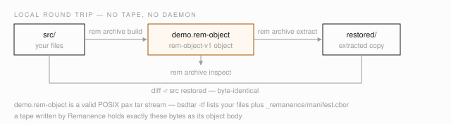

<!-- code-anchor: Cargo.toml crates/remanence-cli/src/lib.rs crates/remanence-cli/src/archive_ingest.rs crates/rem-recover/src/main.rs @ 625f7044 -->
# Quickstart

This tutorial is for a newcomer who wants to see Remanence work, from a clean
checkout to a first tape. In the first part you build Remanence, pack a small
directory into an object file on your local disk, look inside it, and restore
it, first in plaintext and then encrypted. That part needs no tape drive and no
special privileges. The second part writes the same files to a tape in a
changer library through the daemon, and reads one back.

An **object** is the unit Remanence stores: an archive of one or more files.
On tape, each object is one tape file, the run of blocks between two filemarks
(the separators the drive records). On local disk, an object is an ordinary
file, and it holds exactly the bytes that a tape write would store.

The page was checked against the source at version 0.2.0. There is no binary
release yet, so you build from source
([Releases and versions](status.md#releases-and-versions) has the detail).

## What you need

- A Linux host with `git`, a C compiler and Rust 1.88 or newer.
  [Installing Remanence](guide-install.md#before-you-start) lists the packages.
- `bsdtar` (the `libarchive-tools` package on Debian and Ubuntu, `bsdtar` on
  Fedora). The first part uses it to list an object's contents.
- Python 3, for one key-file conversion in the encrypted part.
- For the second part only: a tape library (physical, or a virtual one such as
  QuadStor), a blank LTO cartridge in one of its slots, and `sudo` on the host.

<!-- code-anchor: Cargo.toml crates/remanence-cli/Cargo.toml @ 625f7044 -->
## Build

Clone the repository, build it, and put the programs on your path for this
shell:

```sh
git clone https://github.com/archivetechie/remanence
cd remanence
cargo build --release --locked
export PATH="$PWD/target/release:$PATH"
rem --version
```

The first build takes a while. When it finishes, `rem --version` prints:

```text
rem 0.2.0
```

The build made four programs in `target/release/`: `rem` (the operator tool),
`rem-debug` (the break-glass tool), `rem-daemon` (the service that runs a
library) and `rem-recover` (a recovery tool for encrypted objects). The rest of
this page assumes the `export` line is in effect.

<!-- code-anchor: crates/remanence-cli/src/lib.rs crates/remanence-cli/src/archive_ingest.rs @ 625f7044 -->
## First archive, no tape required

From the checkout directory, make a small directory to archive, with one text
file and one 100 kB file of random bytes, and change into `demo`:

```sh
mkdir -p demo/src/photos
echo "first file" > demo/src/notes.txt
head -c 100000 /dev/urandom > demo/src/photos/img001.raw
cd demo
```

### Build an object

Build an object from `src`:

```sh
rem archive build --inputs src --out demo.rem-object
```

The command writes `demo.rem-object` and prints a build report as one line of
JSON. Here it is formatted and trimmed to the fields discussed below; your IDs
and the digest of the random file will differ:

```text
{
  "body_format": "rem-object-v1",
  "chunk_size": 262144,
  "files": [
    {
      "file_sha256": "7ca46ed8705ae80e983715aa2d60e4c49c87465c9d9467cafddf02bfadf6fc77",
      "first_chunk_lba": 1,
      "path": "notes.txt",
      "size_bytes": 11,
      ...
    },
    {
      "file_sha256": "65bb8f512b8b27e965d85e1511c1f4553d871566c4fecdd7cd272b9cccaf98b5",
      "first_chunk_lba": 2,
      "path": "photos/img001.raw",
      "size_bytes": 100000,
      ...
    }
  ],
  "object_id": "fdb836a0-0b52-4323-be2e-12c384af2bd4",
  "representation": "plaintext",
  "stored_size_blocks": 4,
  "stored_size_bytes": 1048576,
  ...
}
```

The object is laid out in chunks of 256 KiB (`chunk_size`), and each file's
data starts on a chunk boundary (`first_chunk_lba`). That is why two small
files make a 1 MiB object of four chunks. Each file carries its SHA-256, so a
restore can check every file without any host state. A system that manages the
archive above Remanence, which these pages call an orchestrator, would keep this
report.

### Look inside it

Read the object's file list back without extracting anything:

```sh
rem archive inspect --object demo.rem-object
```

It prints one line of JSON. Formatted and trimmed, it shows the same files,
read this time from the object itself:

```text
{
  "body_format": "rem-object-v1",
  "files": [
    {
      "file_sha256": "7ca46ed8705ae80e983715aa2d60e4c49c87465c9d9467cafddf02bfadf6fc77",
      "path": "notes.txt",
      "size_bytes": 11,
      ...
    },
    {
      "path": "photos/img001.raw",
      "size_bytes": 100000,
      ...
    }
  ],
  "object_id": "fdb836a0-0b52-4323-be2e-12c384af2bd4",
  "representation": "plaintext",
  "schema_version": "1.0",
  ...
}
```

An object is also a standard POSIX pax archive (the `tar` format POSIX
defines), so ordinary tar tools can read it without Remanence:

```sh
bsdtar -tf demo.rem-object
```

```text
notes.txt
photos/img001.raw
_remanence/manifest.cbor
```

The last entry is the object's manifest, a CBOR index that records each file's
position and digest.

### Restore it

Extract the object into a new directory and compare the result with the
original:

```sh
rem archive extract --object demo.rem-object --dest restored
diff -r src restored && echo identical
```

`extract` prints a JSON report (trimmed here), and `diff` finds no difference:

```text
{"bytes_written":100011,"dest":"restored","files_written":2,...,"representation":"plaintext",...,"warnings":[]}
identical
```



*Fig. 1. The local round trip: build an object from a directory, read it back,
and check that the copies are identical. A tape write stores these same bytes.*

<!-- code-anchor: crates/remanence-cli/src/lib.rs crates/remanence-aead/src/lib.rs crates/rem-recover/src/main.rs @ 625f7044 -->
## The encrypted variant

An encrypted object wraps the same tar stream in an authenticated envelope.
Each encrypted object is sealed to between two and eight recipient keys, so
that losing one private key does not lose the data, and any one of the private
keys opens it. Each recipient key has a slot number, and a build takes the keys
in ascending slot order.

### Make two keys

Create a working key and a recovery key:

```sh
rem archive recipient keygen --out primary.remp --label primary
rem archive recipient keygen --out recovery.remp --label recovery
```

Each command prints one line:

```text
{"epoch_id":"2ec819840bc9679d1f105ddf676ff5e8","label":"primary","observed_endpoints":[],"private":"primary.remp","public":"primary.remr","supported_endpoint_kinds":["library","standalone"]}
{"epoch_id":"d4ac7d125de6068091d44056102ff9be","label":"recovery","observed_endpoints":[],"private":"recovery.remp","public":"recovery.remr","supported_endpoint_kinds":["library","standalone"]}
```

Each command wrote a private key file (`.remp`, created with mode 0600) and a
public recipient file (`.remr`). The `epoch_id` identifies the key. `keygen`
always writes the public file for slot 0, so the two public files now share a
slot. A build given both refuses with
`--recipient epochs must be distinct and in ascending slot order`.

Give the recovery key slot 1. `rem archive recipient derive` prints the slot-1
public record as JSON, and a short Python script writes it over
`recovery.remr`:

```sh
rem archive recipient derive --private-key recovery.remp --slot-index 1 > recovery-public.json
python3 - <<'KEYS'
import base64, json
from pathlib import Path
record = json.loads(Path("recovery-public.json").read_text())
Path("recovery.remr").write_bytes(base64.b64decode(record["canonical_public_key_base64"]))
KEYS
rem archive recipient inspect --public-key recovery.remr
```

`inspect` confirms the new slot:

```text
{"epoch_label":"recovery","observed_endpoints":[],"public_key_bytes":1216,"recipient_epoch_id":"d4ac7d125de6068091d44056102ff9be","slot_index":1,"supported_endpoint_kinds":["library","standalone"]}
```

In real use, keep the two private files in separate safe places, away from the
tapes. A lost private file cannot be recovered. The public files can be copied
freely.

### Build, inspect and restore the encrypted object

Build an encrypted object sealed to both keys, then inspect it:

```sh
rem archive build --inputs src --out demo-enc.rem-object \
    --recipient primary.remr --recipient recovery.remr
rem archive inspect --object demo-enc.rem-object
```

The build report has the same shape as before, now with
`"representation":"encrypted"`. The inspection, formatted and trimmed, shows
the envelope:

```text
{
  "encryption": "REMO",
  "format_version": 2,
  "keyed": false,
  "recipient_epochs": [
    { "epoch_id": "2ec819840bc9679d1f105ddf676ff5e8", "label": "primary" },
    { "epoch_id": "d4ac7d125de6068091d44056102ff9be", "label": "recovery" }
  ],
  "representation": "encrypted",
  "stored_size_bytes": 1310720,
  ...
}
```

`inspect` needs no key. It checks the envelope's header and lists the
recipients, but it cannot show the file list, which is inside the encryption.

To restore, give one private key:

```sh
rem archive extract --object demo-enc.rem-object --dest restored-enc \
    --private-key primary.remp
diff -r src restored-enc && echo identical
```

```text
{"bytes_written":100011,"dest":"restored-enc","encryption":"REMO","files_written":2,...,"representation":"encrypted",...}
identical
```

Without `--private-key`, `extract` refuses with
`error: encrypted REM-OBJECT operation requires --private-key`.

### Recover with rem-recover

`rem-recover` is a separate, small program for the worst case: it opens one
encrypted object with one private key and needs no daemon, catalog or
configuration file. Recover the object with the recovery key:

```sh
rem-recover --object demo-enc.rem-object --private-key recovery.remp --out recovered
diff -r src recovered && echo identical
```

```text
recovered 2 files (100011 bytes) from REM-OBJECT v2 object 09de23e0-6e38-42e5-b0de-28e6b14a25b5
skipped_xattrs: {}
applied_privileged_xattrs: {}
identical
```

A plaintext object needs no recovery tool at all, because `bsdtar` can extract
it. To change an encrypted object's recipients later, `rem archive reseal`
re-seals it to a new set; the [CLI reference](reference-cli.md) describes it.

<!-- code-anchor: crates/remanence-cli/src/standalone.rs @ 625f7044 -->
## A first tape with one drive

If your hardware is one LTO drive with no changer, `rem` operates it directly,
without the daemon. That path has its own tutorial,
[Using a standalone LTO drive](guide-standalone-drive.md), which sets up the
drive, initializes a cartridge, writes and restores files, and finalizes the
tape. Standalone mode has model-backed tests but has not yet run on a physical
standalone drive ([tested hardware](status.md#tested-hardware)).

The rest of this page is for a changer library.

<!-- code-anchor: crates/remanence-library/src/discovery.rs crates/remanence-cli/src/lib.rs @ 625f7044 -->
## Talking to a library (requires hardware)

From here on you need a tape library with a blank LTO cartridge in one of its
slots. The examples use barcode `RMJ101L9` for that cartridge. The barcode is
the label the changer reads from the cartridge, and its last two characters
(`L9`) name the LTO generation. Run the commands from the checkout directory.

### Open the two host gates

Two separate gates must be open before any SCSI command reaches the hardware.
Your account must be in the `tape` group, which lets it open the `/dev/sgN`
device nodes. The binaries need the `CAP_SYS_RAWIO` capability, because the
kernel filters most tape and changer commands from callers without it. Join
the group, then log out and back in:

```sh
sudo usermod -aG tape "$USER"
```

After logging in again, change to the checkout directory and repeat the
`export` line from [Build](#build). Then give `rem` and `rem-daemon` the capability and check
it:

```sh
sudo setcap cap_sys_rawio+ep target/release/rem
sudo setcap cap_sys_rawio+ep target/release/rem-daemon
getcap target/release/rem target/release/rem-daemon
```

```text
target/release/rem cap_sys_rawio=ep
target/release/rem-daemon cap_sys_rawio=ep
```

Do not run `rem` with `sudo`. A rebuild replaces the binaries and drops the
capability, so repeat `setcap` after every `cargo build`. If the checkout is on
a filesystem mounted `nosuid`, Linux ignores the capability; install the
binaries as [Installing Remanence](guide-install.md#install-the-binaries)
describes and use those instead. That page also covers the lock directory and
the memory-lock limit, which a long-running installation needs.

### Find the library

List the libraries on this host:

```sh
rem libraries
```

It prints one line per library: its serial number, the changer's vendor and
model, its device node, and its shape. The values below are illustrative; yours
name your own library:

```text
LIB0001234  HPE MSL3040  /dev/sg5  (2 drives, 40 slots [12 loaded], 0 IE)
```

`[12 loaded]` counts the slots that hold a cartridge, and `IE` counts the
import/export ports (mailslots). Discovery is read-only. It sends INQUIRY (the
identity query every SCSI device answers), reads vital product data pages, and
asks the changer for its inventory with READ ELEMENT STATUS. It moves nothing.
Use the serial it printed wherever this page shows `<SERIAL>`.

To see every slot, focus on that library:

```sh
rem library <SERIAL> --slots
```

The output describes the changer and its drives, and ends with one line per
storage slot (shortened here):

```text
...
Slots:
  [0x0400] full   RMJ101L9
  [0x0401] empty
...
```

Both commands also take `--json`.

<!-- code-anchor: crates/remanence-daemon/src/entry.rs crates/remanence-state/src/config.rs crates/remanence-state/src/lock.rs @ 625f7044 -->
## Running the daemon (requires hardware)

The daemon reads a configuration file. Create the state directory, owned by
the account that will run the daemon, and save a minimal configuration as
`/etc/rem/config.toml`. Replace `<SERIAL>` with your library's serial:

```sh
sudo install -d -o "$USER" -m 0700 /var/lib/rem
sudo install -d /etc/rem
sudo tee /etc/rem/config.toml > /dev/null <<'TOML'
[daemon]
state_dir = "/var/lib/rem"
default_idle_timeout_seconds = 300

[[libraries]]
serial = "<SERIAL>"

[[tape_pools]]
id = "archive"

[[tape_pool_rules]]
prefix = "RMJ"
pool_id = "archive"

[journal]
dir = "/var/lib/rem/journal"

[audit]
dir = "/var/lib/rem/audit"

[index]
sqlite_path = "/var/lib/rem/rem-state.sqlite"

[cache]
tape_catalog_dir = "/var/lib/rem/tape-catalog"
TOML
```

The daemon acts only on the libraries listed under `[[libraries]]`. A **tape
pool** is a named set of tapes that writes are directed to, and the rule puts
every cartridge whose barcode begins with `RMJ` into the pool `archive`.
`default_idle_timeout_seconds` is how long a session may sit idle before the
daemon ends it. The `[journal]` directory holds the tape logs, the host's
per-tape record of what has been committed; the section keeps an older name.
The last three sections place the audit log, the catalog (a SQLite projection
of the tape logs and the audit log) and a cache. The
[configuration reference](reference-configuration.md) describes every key.

Creating `/etc/rem/config.toml` also changes how `rem` routes commands on this
host. Standalone commands then use this file and its state instead of the
home-mode state under `${XDG_STATE_HOME:-$HOME/.local/state}/rem/`, and shared
verbs such as `put`, `get`, `tape init` and `tape finalize` take the library
route. If you also use a standalone drive on this host, read the
[routing table](reference-cli.md#standalone-drives) first.

Start the daemon in the foreground, in its own shell:

```sh
rem-daemon --config /etc/rem/config.toml
```

It writes its log to standard error as JSON lines, and one plain line says
where it is listening:

```text
...
rem-daemon: serving local Layer 5 API on unix:/var/lib/rem/rem.sock
...
```

From another shell, as the same account, check that it answers:

```sh
rem daemon health
rem daemon version
```

```text
status: healthy
detail: sqlite quick_check=ok
components:
  sqlite_index: healthy
daemon: 0.2.0
api: v1-draft
target: x86_64-linux
```

The `rem` commands that talk to the daemon connect to
`unix:/var/lib/rem/rem.sock` by default. If your `state_dir` is elsewhere, pass
`--endpoint unix:<state_dir>/rem.sock`. The socket admits only root and the
daemon's own account (see `socket_path` in the
[configuration reference](reference-configuration.md#daemon-required)).

For a service, run the daemon under systemd and grant the capability in the
unit rather than on the binary:

```ini
[Service]
AmbientCapabilities=CAP_SYS_RAWIO
CapabilityBoundingSet=CAP_SYS_RAWIO
```

<!-- code-anchor: crates/remanence-cli/src/lib.rs crates/remanence-api/src/tape_init.rs crates/remanence-parity/src/lib.rs @ 625f7044 -->
## Initializing a tape (requires hardware, writes to media)

A cartridge must be initialized before a pool accepts it. Initialization
writes the bootstrap, the self-describing block at the beginning of the tape,
which records a new tape UUID, the block size and the parity scheme. The tape
UUID, not the barcode, is the tape's identity from then on.

`rem tape init` opens the local state directly and takes the same exclusive
state lock as the daemon, so stop the daemon first (press Ctrl-C in its shell).
While the daemon runs, init refuses with
`error: state lock is already held: /var/lib/rem/state.lock`.

Start with a dry run. It moves the cartridge into a free drive and runs every
check, but writes nothing:

```sh
rem tape init RMJ101L9 --parity default --dry-run
```

```text
tape init RMJ101L9: dry-run-would-write
...
  decision: fresh-init
```

`fresh-init` means the checks found a blank cartridge that may be initialized.
Now initialize it. `--parity default` selects Remanence's default Reed-Solomon
parity, which lets a reader rebuild unreadable regions of the tape:

```sh
rem tape init RMJ101L9 --parity default
```

The command prints what it wrote. The tape UUID is new each time; the element
addresses and the serial below are illustrative:

```text
tape init RMJ101L9: wrote-bootstrap
  uuid: 5e8f8d3b-0c1a-4d2e-9f60-7a1b2c3d4e5f
  library: LIB0001234
  source: 0x0400; drive: 0x0001
  pool: archive
  generation: LTO-9
  capacity_bytes: 18000000000000
  geometry: block_size=262144 parity=rs-cauchy-gf256-v1
  decision: fresh-init
```

The first load of a new LTO-9 cartridge starts a media optimization in the
drive that can take up to two hours, and it should not be interrupted. If init
stops with a message that begins `media not ready for tape init on RMJ101L9`,
leave the cartridge in the drive, wait for it with
`rem tape wait-ready --barcode RMJ101L9 --wait` (which polls for up to 2.5
hours by default), and run init again.

Used cartridges need more care: init refuses a tape that holds data unless you
pass `--clobber-data` and confirm. The [CLI reference](reference-cli.md)
describes those options.

<!-- code-anchor: crates/remanence-cli/src/put.rs crates/remanence-cli/src/get.rs @ 625f7044 -->
## First write to tape (requires hardware, writes to media)

Start the daemon again in its own shell, as before:

```sh
rem-daemon --config /etc/rem/config.toml
```

### Put files on the tape

From the checkout directory in your other shell, archive the demo files to the
pool:

```sh
rem put demo/src --pool archive
```

`rem put` walks the directory and makes one object of each regular file. Its
progress goes to standard error, and the receipt for each committed object to
standard output. The object and session IDs and the rates below are
illustrative:

```text
writing 2 files (97.7 KiB) to pool archive
  demo/src/notes.txt (11 B) spooled at 0 MiB/s, pending checkpoint
  demo/src/photos/img001.raw (97.7 KiB) spooled at 24 MiB/s, pending checkpoint
demo/src/notes.txt  object 3f2a9c1e-7b4d-4e8a-9c61-0d5e2f7a8b93  tape RMJ101L9 file 1  pool archive
demo/src/photos/img001.raw  object 8b17e4d2-5a6c-4f3b-a0e9-2c7d1b6f4e58  tape RMJ101L9 file 2  pool archive
session 6c0e3b9a-1d2f-4a7e-8b5c-9f4d2e1a7c36 closed: 2 objects, 97.7 KiB committed
```

The daemon chose a tape from the pool, mounted it, and wrote each object as one
tape file after the bootstrap (tape file 0). "Pending checkpoint" means the
data had reached the daemon but was not yet durable. The receipt lines appear
only after the session's checkpoint. A checkpoint first sends a barrier, which
makes the drive write its buffer to the medium and proves the tape position;
then it writes a durable commit record for each object to the tape log. An
object with a commit record is **committed**. Its parity may reach the tape
later, and data that a parity sidecar on tape covers is called **protected**.

### Get a file back

Restore one object by the name `rem put` gave it, which is its archive path,
and compare it with the original:

```sh
rem get demo/src/notes.txt --caller-id --pool archive --dest restored-tape
cmp demo/src/notes.txt restored-tape/demo/src/notes.txt && echo identical
```

```text
restoring 1 member (11 B) of object 3f2a9c1e-7b4d-4e8a-9c61-0d5e2f7a8b93 from tape 5e8f8d3b-0c1a-4d2e-9f60-7a1b2c3d4e5f file 1
  demo/src/notes.txt (11 B) verified at 0 MiB/s
demo/src/notes.txt  11 B  sha256 7ca46ed8705a  → restored-tape/demo/src/notes.txt
object 3f2a9c1e-7b4d-4e8a-9c61-0d5e2f7a8b93 restored into restored-tape (1 member, 11 B, all digests verified)
identical
```

`--caller-id` tells `rem get` that the argument is the name recorded at put
time rather than an object UUID. The daemon read the copy from tape, and
`rem get` checked its SHA-256 against the digest in the catalog before it
reported success.

### When parity reaches the tape

The paragraphs below describe when the parity for committed data is written to
tape. You do not need them to finish this tutorial.

Daemon and in-process write sessions keep a short epoch across ordinary
checkpoint barriers. Standalone `rem put` and pool-selected `rem-debug archive
write` use that same actor policy; finishing the command closes any remaining
short epoch without unloading the cartridge.

A checkpoint drains the drive, proves the end position, and commits the per-tape log
and catalog. A CHECKPOINTED receipt keeps this meaning on a parity pool even
when the newest committed data awaits parity. A short epoch stays open across
ordinary checkpoints. Completed epochs emit their sidecars after the Object
filemark; finalization closes its short epoch with `FINAL_PARTIAL_EPOCH`.
Cartridge removal attempts to close an admitted open epoch without automatic
finalization. It records a due seal as `seal_due` in the fsynced per-tape log and
projects it into the catalog, visible in `rem catalog tapes
--json`; the next write session on that tape or explicit finalize completes it.

While the cartridge stays seated, fewer than `S × k` committed data blocks can
lack on-tape parity. At the default geometry this window is less than 16 GiB.
The drive actor retains the accumulator between sessions under
`daemon.io_memory_ceiling`. If it cannot reserve that memory, the barrier closes
the short epoch instead. `rem catalog tapes --json` reports the pending range as
`open_epoch_start` and `open_epoch_end`; `rem top` shows it on the loaded tape.
Both fields clear when the sidecar commits.

A new session proves tape identity and end of data before reusing retained state.
A restart or mismatched state rebuilds the open epoch by reading its committed
range before the next write. On shutdown, the daemon closes the epoch only if
no read or other positioning follows the last write and the head remains at
that end position. Otherwise it dismounts and logs and audits `epoch_left_open`
with `[W,T)`; the next append rebuilds the epoch. Removal always proceeds.
Non-writable, foreign, unconfigured, and terminal-finalizing tapes skip the close
with a log entry. A close records a tape-I/O fence when the tape contradicts
committed state or an append has uncertain durability. A contradiction fence
carries the range and cause; a write-failure fence carries the batch evidence.
Transient failures log and audit `epoch_left_open` without a fence. A durable
journal commit stays closed when SQLite projection fails; startup replay
projects it.
A cartridge outside a drive has no open epoch except after a crash, a close that
leaves the epoch open, or a shutdown that finds the head away from EOD. A fenced
tape keeps its open epoch until append recovery clears the fence.

## Where to go next

- [Using a standalone LTO drive](guide-standalone-drive.md): the complete
  one-drive workflow, without a changer or daemon.
- [CLI reference](reference-cli.md): every command and option.
- [Configuration reference](reference-configuration.md): every configuration
  key, default and environment variable.
- [Architecture overview](architecture-overview.md): how the parts fit together
  and what the write path does.
- [On-tape layout reference](reference-tape-layout.md): what ends up on the
  cartridge.
- [Troubleshooting](guide-troubleshooting.md): failure modes and what they mean.
