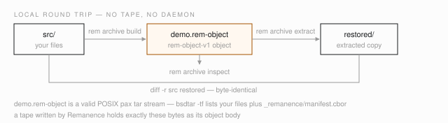

# Quickstart

This walkthrough goes from a clean checkout to a verified archive
round trip on your local disk, then to real hardware. The local part
needs no tape drive, no library, and no elevated privileges — the native
object format works against ordinary files, and it is the same code path
the tape write uses.

Commands in the local sections were run as written against the current
tree; hardware sections are marked. Remanence supports two hardware paths:
one manually loaded standalone drive operated directly by `rem`, or a changer
library operated through `rem-daemon`.

<!-- code-anchor: Cargo.toml crates/remanence-cli/Cargo.toml crates/remanence-api/build.rs crates/remanence-cli/src/archive_ingest.rs @ 6ed03ef0 -->
## Build

You need Linux, a C compiler (`build-essential` on Debian/Ubuntu, `gcc` on
Fedora) and Rust 1.88 or newer (rustup). The protobuf definitions are compiled
in-process, so `protoc` is not needed:

```sh
git clone https://github.com/archivetechie/remanence
cd remanence
cargo build --release
```

That produces four binaries under `target/release/`: `rem` (operator
CLI), `rem-debug` (break-glass CLI), `rem-daemon` (the service), and
`rem-recover` (a standalone catalogless disaster-recovery tool — see the
[CLI reference](reference-cli.md#rem-recover-standalone-recovery)).

One optional cargo feature widens the core surface:

- `--features remanence-cli/linux-udev` enables `rem watch` (hot-plug
  events); it needs the `pkg-config` and `libudev-dev` system packages.

Foreign-format adapters are separate distributions rather than Cargo features
of the core repository. See the
[foreign-format adapter reference](reference-foreign-format-adapters.md).

One program is needed at run time, and the first walkthrough below uses it:
`bsdtar` (the `libarchive-tools` package on Debian and Ubuntu, `bsdtar` on
Fedora). `rem archive build` needs it only to build an archive that packs
files into a `.remwrap.tar` wrapper, and `rem archive extract` only to extract
a whole object that contains one, unless `--no-unwrap` is given. Extract
checks for it before it writes anything. Range (`--path`/`--range`) and
blob-member (`--blob-entry`/`--blob-member`) extracts never need it.

To run the test suite the way CI does (it also needs `bsdtar`):

```sh
cargo fmt --all --check
cargo clippy --workspace --all-targets -- -D warnings
cargo test --workspace
```

Hardware and large-memory tests are `#[ignore]`d by default and opt in
through environment variables documented in their test modules.

<!-- code-anchor: crates/remanence-cli/src/lib.rs crates/remanence-cli/src/archive_ingest.rs @ 6ed03ef0 -->
## First archive, no tape required

Build a stored object from a directory, look inside it, and restore it.
Make some input:

```sh
mkdir -p demo/src/photos
echo "first file" > demo/src/notes.txt
head -c 100000 /dev/urandom > demo/src/photos/img001.raw
cd demo
```

Build a REM-OBJECT object:

```sh
rem archive build --inputs src --out demo.rem-object
```

The command prints a JSON build report: the object id, the chunk size
(262144 bytes by default), and one entry per file with its SHA-256, size,
and position inside the object. This report is what a system that manages the
archive (an orchestrator) would store; every field in it is also recoverable from the object itself.

Inspect the object without extracting it:

```sh
rem archive inspect --object demo.rem-object
```

Then restore and compare:

```sh
rem archive extract --object demo.rem-object --dest restored
diff -r src restored && echo identical
```

Two properties of the object are worth knowing. First, `demo.rem-object` is a valid POSIX pax tar
stream padded to fixed-size chunks — `bsdtar -tf demo.rem-object` lists your
files plus a `_remanence/manifest.cbor` index entry. A tape written by
Remanence holds exactly these bytes as its object body, so no Remanence
software is needed to get the data back, which matters for an archive that
must stay readable for decades. Second, every file's SHA-256 travels with it, so verification
never depends on host state.



*Fig. 1 — The local round trip: build a rem-object-v1 object from a directory, read it back, and prove the copies identical — the same bytes a tape write stores as the object body.*

<!-- code-anchor: crates/remanence-cli/src/lib.rs crates/remanence-aead/src/lib.rs crates/remanence-aead/src/wrap.rs crates/remanence-aead/src/xwing.rs @ 6ed03ef0 -->
## The encrypted variant

The encrypted representation wraps the same tar stream in an
authenticated ChaCha20-Poly1305 envelope. This is the only encrypted
representation: every
object gets a fresh data-encryption key, wrapped separately to each
recipient with HPKE (RFC 9180 Base mode, HKDF-SHA256, ChaCha20-Poly1305)
running the X-Wing post-quantum/classical hybrid KEM (ML-KEM-768
combined with X25519). Writers require 2-8 distinct, nonzero recipient epochs in
ascending slot order.

Create private REMP and public REMR files with `rem archive recipient keygen`.
Follow the [encryption steps](guide-standalone-drive.md#encryption) to generate
`primary.remp`/`primary.remr` and `recovery.remp`/`recovery.remr`, assign the
recovery public record slot 1, and store the private files safely. Then build:

```sh
rem archive build --inputs src --out demo-enc.rem-object \
    --recipient primary.remr --recipient recovery.remr
rem archive inspect --object demo-enc.rem-object
rem archive extract --object demo-enc.rem-object --dest restored-enc \
    --private-key primary.remp
diff -r src restored-enc && echo identical
```

`inspect` needs no key. It validates the envelope header and key frame and reports
the ordered `recipient_epochs`, but cannot expose the encrypted manifest.
The matching REMP file selects its epoch's slot during open.

To rotate recipients, open the existing encrypted object with one current private
key and reseal it to a new 2-8-recipient set:

```sh
rem archive reseal --object demo-enc.rem-object --private-key primary.remp \
    --recipient primary-rotated.remr recovery.remr \
    --out demo-rotated.rem-object
```

`reseal` performs a full re-seal: it verifies the new stored digest before
publishing and never overwrites an existing output. It always emits an encrypted
envelope.

For catalogless disaster recovery, use the standalone `rem-recover` binary
with any matching recipient private key:

```sh
rem-recover --object demo-enc.rem-object --private-key recovery.remp --out recovered
diff -r src recovered && echo identical
```

`rem-recover` needs no daemon, catalog, or config file. It is the
disaster-recovery path of last resort for an encrypted envelope; a plaintext
REM-OBJECT remains an ordinary pax archive and can be inspected or extracted
with `bsdtar`. For streaming and partial retrieval,
`archive extract-stream` and `archive covering-range` use the same
`--private-key` epoch-selection contract.

<!-- code-anchor: crates/remanence-cli/src/standalone.rs crates/remanence-api/src/mount_backend.rs @ 4dc2a3c6 -->
## First physical tape with one drive

No published binary has standalone mode yet. Build from source using the
commands above, then put the release directory on your path:

```sh
export PATH="$PWD/target/release:$PATH"
```

Complete the [permissions steps](guide-standalone-drive.md#what-you-need),
including the persistent `/run/lock/rem` rule, and log in again after joining
`tape`. After logging in, return to the checkout with `cd remanence` and repeat
`export PATH="$PWD/target/release:$PATH"`. Never run rem with sudo. No daemon is needed.

On a host without `/etc/rem/config.toml`, setup saves your selected drive's
serial in the home config. Insert a blank LTO-9 cartridge, write HOME01 on its
shell, and run:

```sh
rem setup
rem doctor
rem drives --json
rem tape init --label HOME01 --generation L9
rem put "$HOME/Documents"
rem list
rem list --tape HOME01 --path-prefix Documents/
rem get Documents/notes.txt --out restored
rem tape finalize --acknowledge-tape HOME01
rem tape verify
rem tape verify --full
rem tape restore --list
rem tape restore --path Documents/notes.txt --out recovered
```

Replace `Documents/notes.txt` with a path from the listing. Use `--generation L6`
for an LTO-6 cartridge in a compatible drive; supported values are L5–L9 and M8.
Initialization writes immediately and has no standalone dry run. Used media
needs `--clobber-data` and the exact `CLOBBER HOME01` confirmation. An LTFS
cartridge first needs repartitioning: install `mt-st`, find the matching `nstN`
with `ls /sys/class/scsi_generic/sgN/device/scsi_tape/` (`stN` maps to
`/dev/nstN`), then run
`sudo mt -f /dev/nstN stsetoptions can-partitions` and
`mt -f /dev/nstN mkpartition 0`. This erases the cartridge. Follow
[step 2](guide-standalone-drive.md#2-initialize-a-cartridge), rerun init, and
add clobber only if it still reports data at BOT.

Compare your restored file before shelving the tape. Finalization permanently
closes it to new objects. When verification exits, eject with the drive button
or `mt -f /dev/nst0 eject` from `mt-st`, using the `nstN` found through the
sysfs lookup above for this drive. The [standalone guide](guide-standalone-drive.md) covers tape-full continuation,
second copies, old versions, crash recovery and encryption keys.

<!-- code-anchor: crates/remanence-library/src/discovery.rs crates/remanence-cli/src/lib.rs Makefile @ 6ed03ef0 -->
## Talking to a library (requires hardware)

From here on you need a tape library — a real chassis or a virtual one
(the project develops against Quadstor VTL). Two host-side gates must be
open before any SCSI command works:

1. Your user must be in the `tape` group (this gates opening
   `/dev/sgN`): `sudo usermod -aG tape $USER`, then log in again.
2. The binary needs `CAP_SYS_RAWIO` (the kernel filters most SCSI
   opcodes for everyone else): `sudo setcap cap_sys_rawio+ep
   target/release/rem`.

Rebuilding drops the capability with the binary's inode; `make rem-dev`
rebuilds the debug binary and reapplies it in one step. If you skip these
gates, discovery fails with an explicit EPERM hint — see
[troubleshooting](guide-troubleshooting.md).

Now discover:

```sh
rem libraries
```

Each line is one library with its serial, model, changer device, and
shape (drives, slots, IE ports, loaded cartridges). Focus on one, with
its slot map:

```sh
rem library <SERIAL> --slots
```

Both commands take `--json` for scripting. Discovery is read-only: it
issues INQUIRY, VPD, and READ ELEMENT STATUS, and moves nothing.

<!-- code-anchor: crates/remanence-daemon/src/entry.rs crates/remanence-state/src/config.rs @ 1dd451b2 -->
## Running the daemon (requires hardware)

The daemon needs a config file. A minimal one, using `/var/lib/rem` for
state (see the [configuration reference](reference-configuration.md) for
every key):

```toml
[daemon]
state_dir = "/var/lib/rem"
default_idle_timeout_seconds = 300

[[libraries]]
serial = "<SERIAL>"          # from `rem libraries`; the daemon only
                             # touches libraries listed here

[[tape_pools]]
id = "demo"

[[tape_pool_rules]]
prefix = "DMO"               # barcodes DMO... belong to pool "demo"
pool_id = "demo"

[journal]
dir = "/var/lib/rem/journal"

[audit]
dir = "/var/lib/rem/audit"

[index]
sqlite_path = "/var/lib/rem/rem-state.sqlite"

[cache]
tape_catalog_dir = "/var/lib/rem/tape-catalog"
```

Start it in the foreground:

```sh
rem-daemon --config /etc/rem/config.toml
```

It logs JSON to stderr and announces `serving local Layer 5 API on
unix:/var/lib/rem/rem.sock`. Under systemd, grant the SCSI capability in
the unit rather than on the binary:

```ini
[Service]
AmbientCapabilities=CAP_SYS_RAWIO
CapabilityBoundingSet=CAP_SYS_RAWIO
```

Check it from another shell:

```sh
rem daemon health
rem daemon version
rem catalog pools
```

If your state dir is not `/var/lib/rem`, pass `--endpoint
unix:<state_dir>/rem.sock` — the CLI default assumes that path.

<!-- code-anchor: crates/remanence-cli/src/lib.rs crates/remanence-api/src/tape_init.rs @ 6ed03ef0 -->
## Initializing a tape (requires hardware, writes to media)

A fresh cartridge must be initialized before a pool will accept it:
Remanence writes the bootstrap block at the beginning of tape, binding a
new tape UUID to the barcode in the catalog. Initialization is
destructive by nature, so it runs a safety gauntlet — identity,
ownership, readiness, and data-presence checks — and refuses anything it
cannot prove. Start with a dry run, which performs every check and
writes nothing:

```sh
rem tape init DMO001L9 --dry-run
rem tape init DMO001L9
```

Batch initialization takes a slot range (`rem tape init
0x0400..0x0407`). Overrides are deliberately narrow: `--force` only
covers decisions the gauntlet classifies as force-overridable, and
`--clobber-data` (for a tape that verifiably holds data) is refused in
dry-run and batch modes.

One hardware reality to plan around: the first load of a new LTO-9
cartridge triggers a one-time media optimization pass in the drive that
can take an hour or more. `rem tape wait-ready --wait` polls until the
medium is genuinely usable, and its defaults (2.5h timeout, 30s
interval) are sized for exactly this.

<!-- code-anchor: crates/remanence-cli/src/rem_debug.rs crates/remanence-cli/src/put.rs @ 244bc6de -->
## First write to tape (requires hardware, writes to media)

With a running daemon, the normal write is one command — `rem put
/path/to/files --pool demo` — which goes through the daemon's session
machinery with its pool policy, fences, and checkpoint durability (see
the [CLI reference](reference-cli.md#writing-to-tape)). This
walkthrough instead uses `rem-debug`, which drives the same pool
machinery directly against hardware without a daemon — useful for a
first hands-on write, at the cost of the break-glass gauntlet. Note the
`--allow` flag: every state-changing `rem-debug` command must name the
library it may touch. Direct Object writes still require the drive to report
the loaded cartridge as rewritable; write-protected, WORM, and unknown media
are refused before MODE SELECT or any tape write.

```sh
rem-debug --allow <SERIAL> archive write \
    --library <SERIAL> --pool demo --file /path/to/payload.bin --json \
    --recipient primary.remr --recipient recovery.remr \
    > locator.json

rem-debug --allow <SERIAL> archive verify \
    --library <SERIAL> --locator "$(cat locator.json)" \
    --private-key primary.remp \
    --expected-sha256 "$(sha256sum /path/to/payload.bin | cut -d' ' -f1)"

rem-debug --allow <SERIAL> archive read \
    --library <SERIAL> --locator "$(cat locator.json)" --out restored.bin \
    --private-key primary.remp
```

Replace `/path/to/payload.bin` with the path of the file you want to store; the
same path appears in the write and verify commands, and `restored.bin` is where
the read writes its copy.

The locator JSON emitted by `write` pins the object copy to physical
media and records `format_version: 2` plus the recipient epochs; `verify`
streams and authenticates the tape object against a digest without restoring
anything.

## Where to go next

- [Standalone-drive guide](guide-standalone-drive.md) — the complete
  one-drive workflow without a changer or daemon.
- [CLI reference](reference-cli.md) — the full command surface.
- [Configuration reference](reference-configuration.md) — every config
  key, default, and environment variable.
- [Architecture overview](architecture-overview.md) — how the crates
  fit together and what the write path actually does.
- [Tape layout reference](reference-tape-layout.md) — what ends up on
  the cartridge.
- [Troubleshooting](guide-troubleshooting.md) — the failure modes and
  what they mean.
